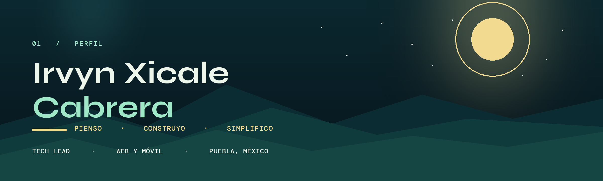
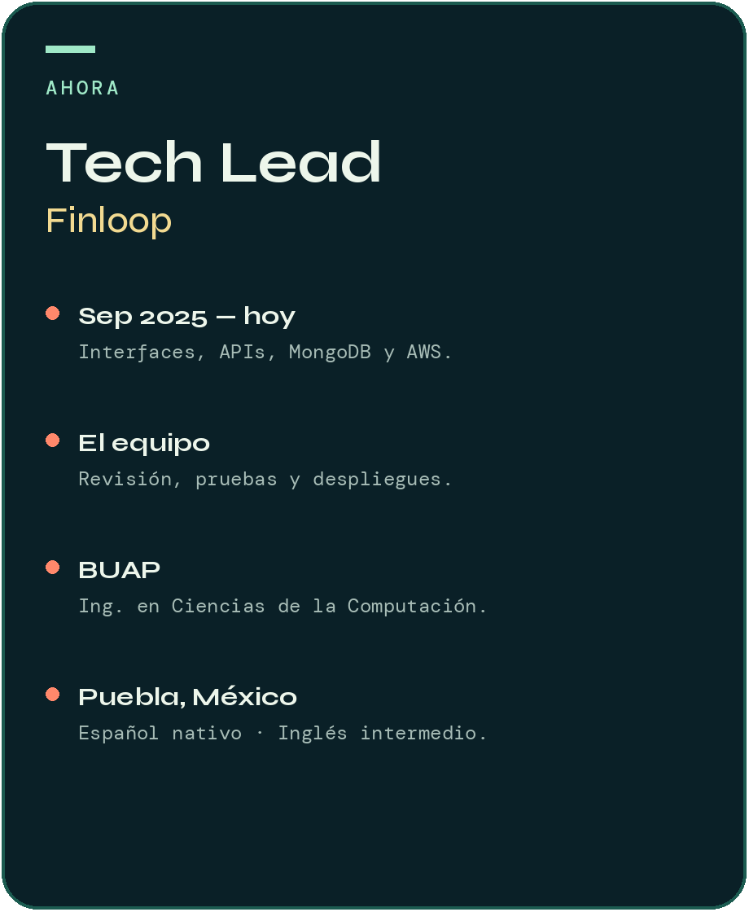
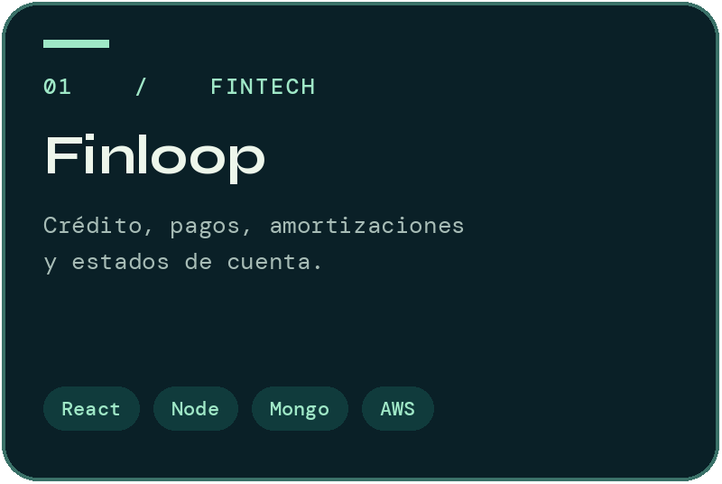
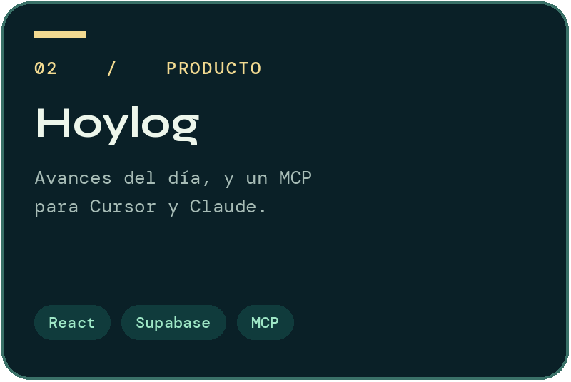
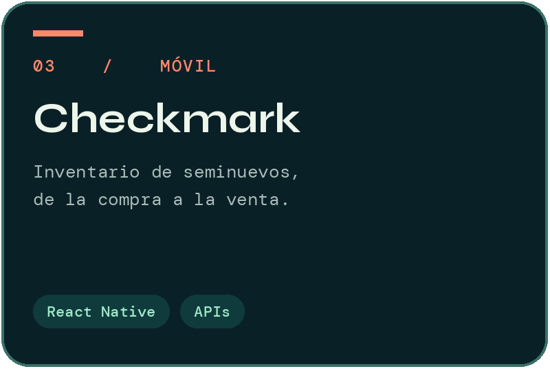

  

  
  
  

Convierto procesos complejos en productos digitales claros: interfaces, APIs y la operación que los mantiene en pie.

Soy ingeniero en Ciencias de la Computación por la BUAP. Desde septiembre de 2025 lidero el desarrollo de Finloop: módulos financieros, MongoDB, pruebas, revisión de código y despliegues en AWS.

Fuera del código juego Apex Legends, dibujo y sigo la tecnología nueva en podcasts y videos. El recorrido completo está en [mi sitio](https://irvyn2703.github.io/).

 

  
  
  

<h3 align="center">Stack</h3>

  

  React · React Native · TypeScript · Node.js · MongoDB · SQL · AWS · Python · Java

<h3 align="center">Open source</h3>

  <a href="https://auracheck.dev/irvyn2703">
    <picture>
      <source media="(prefers-color-scheme: dark)" srcset="https://auracheck.dev/card/irvyn2703.svg?variant=full&theme=dark">
      
    </picture>
  </a>

<h3 align="center">Actividad</h3>

  

  
  

  

